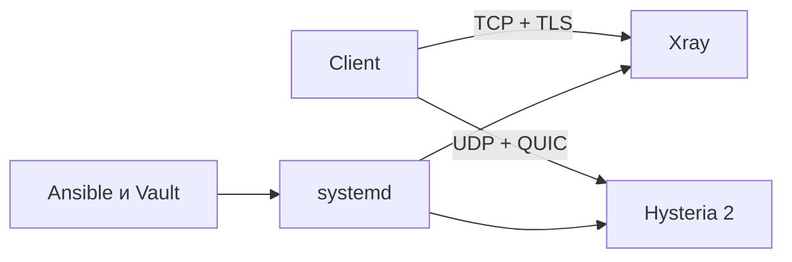

# vpn-server-ansible

[](https://github.com/nikit0id/vpn-server-ansible/actions/workflows/ci.yml)

Роль устанавливает личный Xray/VLESS и Hysteria 2 на Ubuntu x86-64. У каждого клиента своя учётная информация, сервер предъявляет TLS-сертификат. CI запускает оба клиента и проверяет передачу HTTP-ответа на отдельной ВМ.



## Запуск за три команды

Для прогона понадобятся **одноразовая Ubuntu 24.04 x86-64**, Git, Python с venv, OpenSSL и доступ через sudo без пароля. Сценарий устанавливает службы на эту ВМ и слушает только loopback.

```bash
git clone https://github.com/nikit0id/vpn-server-ansible && cd vpn-server-ansible
python3 -m venv .venv && .venv/bin/pip install ansible-core==2.19.15 && .venv/bin/ansible-galaxy collection install -r requirements.yml
PATH="$PWD/.venv/bin:$PATH" ./scripts/rehearse
```

## Что внутри

- Роль проверяет SHA-256 обоих релизов перед установкой. systemd передаёт сертификат и ключ службам через LoadCredential.
- Xray принимает авторизованные соединения по TCP, Hysteria — по UDP. Внешние интерфейсы задаются явно через vpn_listen. Роль добавляет правила портов в UFW. Включение UFW и сохранение доступа SSH выполняет [ansible-linux-baseline](https://github.com/nikit0id/ansible-linux-baseline).
- Для VPS скопируйте hosts.example.yml в hosts.local.yml и укажите ваш сервер. В vars.example.yml приведены пути к действующим сертификатам и публичный адрес привязки. Подготовьте свой файл vars.local.yml. В зашифрованном `ansible-vault create vault.yml` задайте vault_vpn_uuid и vault_vpn_password. Сгенерируйте UUID и минимум 24 случайных символа для пароля.
- Применение: `ansible-playbook -i hosts.local.yml site.yml -e @vars.local.yml -e @vault.yml --ask-vault-pass`. После обновления TLS-ключа перезапустите обе службы, чтобы systemd перечитал credentials.

## Что я узнал

- Один номер порта обслуживает два сервиса, поскольку TCP и UDP используют разные сокеты.
- Активная служба ещё не подтверждает работу клиента. Проверка загружает известный ответ через два независимых SOCKS-подключения с проверкой сертификата.
- Хеш бинарника фиксирует содержимое релиза. Ключ TLS остаётся под управлением systemd и не попадает в шаблоны клиента.

## Что бы сделал дальше

- Подключить перезапуск служб к событию обновления сертификата.
- Добавить отдельную внешнюю проверку UDP для выявления фильтрации у провайдера.
